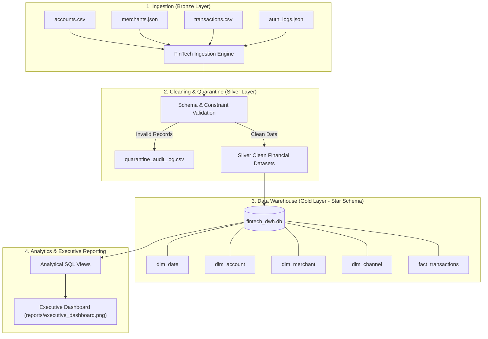

# Practical 10: FinTech Transaction Monitoring & Banking Data Warehouse (Mini Project)

### **Author (Solo Project)**
- **Ayan Patel**

---

## 1. Aim
To design, implement, and deploy an end-to-end FinTech data engineering solution and analytical Data Warehouse that:
1. Ingests heterogeneous financial data sources (Bank Accounts CSV, Merchant Catalog JSON, Card Transactions CSV, and Authentication Logs JSON).
2. Implements a data quality validation gate and quarantine architecture (Medallion Silver Layer).
3. Executes financial calculations (merchant commission fees, net settled amounts) and account risk profiling.
4. Models an analytical Star Schema Data Warehouse in SQLite (`fintech_dwh.db`).
5. Generates business intelligence data marts and an executive visual analytics dashboard.

---

## 2. Brief Theory

### 2.1 Medallion Architecture in Financial Systems
- **Bronze Layer (Raw):** Ingestion of raw transactional events and registry data across multiple protocols.
- **Silver Layer (Cleaned & Quarantined):** Applies automated schema validation, entity deduplication, and referential integrity checks. Corrupted or invalid records (e.g. non-positive amounts, corrupted timestamps, missing accounts or merchants) are segregated into `quarantine_audit_log.csv` with explicit audit reasons.
- **Gold Layer (Analytical DWH):** Curated, highly optimized dimensional model stored in SQLite.

### 2.2 Dimensional Modeling (Star Schema)
The analytical Data Warehouse is organized as a central Fact table referencing four Dimension tables:
- **`dim_date`:** Time intelligence (day, month, quarter, year, weekend indicator).
- **`dim_account`:** Bank account demographic and behavioral risk tier (*High Net Worth*, *High Volume*, *Standard Active*, *Low Activity*).
- **`dim_merchant`:** Merchant profiles, category classification, risk level, and contractual commission rates.
- **`dim_channel`:** Payment rail (UPI, Credit Card, Debit Card, Net Banking, ATM) and settlement status.
- **`fact_transactions`:** Transaction grain capturing financial measures: `amount`, `fee_amount`, `net_amount`, and `is_high_value`.



---

## 3. Code

The complete implementation is available in [`pipeline.py`](./pipeline.py) and interactive notebook [`Practical_10.ipynb`](./Practical_10.ipynb):

```python
import os
import json
import sqlite3
import pandas as pd
import numpy as np
import matplotlib.pyplot as plt
import seaborn as sns

BASE_DIR = os.path.dirname(os.path.abspath(__file__))
DATA_RAW = os.path.join(BASE_DIR, "data", "raw")
DATA_SILVER = os.path.join(BASE_DIR, "data", "silver")
DATA_GOLD = os.path.join(BASE_DIR, "data", "gold")
REPORTS_DIR = os.path.join(BASE_DIR, "reports")

# Stage 1: Ingestion
accounts_raw = pd.read_csv(os.path.join(DATA_RAW, "accounts.csv"))
with open(os.path.join(DATA_RAW, "merchants.json"), "r") as f:
    merchants_raw = pd.DataFrame(json.load(f))
tx_raw = pd.read_csv(os.path.join(DATA_RAW, "transactions.csv"))

# Stage 2: Data Quality & Quarantine
quarantine = []
acc_dedup = accounts_raw.drop_duplicates(subset=["account_id"], keep="first").copy()
clean_acc_list = []
for _, r in acc_dedup.iterrows():
    if r["balance"] < 0 or r["kyc_status"] != "Verified":
        quarantine.append({"record_type": "Account", "identifier": str(r["account_id"]), "reason": "Negative balance or unverified KYC status"})
    else:
        row_dict = r.to_dict()
        row_dict["city"] = str(r["city"]).strip().title()
        clean_acc_list.append(row_dict)
clean_accounts = pd.DataFrame(clean_acc_list)

# Validate Transactions
valid_acc_ids = set(clean_accounts["account_id"])
valid_merch_ids = set([m["merchant_id"] for m in merchants_raw if m["commission_rate"] > 0])
tx_dedup = tx_raw.drop_duplicates(subset=["transaction_id"], keep="first").copy()
clean_tx_list = []

for _, r in tx_dedup.iterrows():
    tid = r["transaction_id"]
    amt = r["amount"]
    if amt <= 0 or r["account_id"] not in valid_acc_ids or r["merchant_id"] not in valid_merch_ids:
        quarantine.append({"record_type": "Transaction", "identifier": tid, "reason": "Validation failure"})
        continue
    clean_tx_list.append(r.to_dict())

clean_tx = pd.DataFrame(clean_tx_list)

# Stage 3: Financial Calculations & Account Risk Profiling
clean_tx["fee_amount"] = clean_tx["amount"] * 0.02
clean_tx["net_amount"] = clean_tx["amount"] - clean_tx["fee_amount"]
clean_tx["is_high_value"] = (clean_tx["amount"] >= 25000).astype(int)

# Stage 4: Star Schema Data Warehouse in SQLite (fintech_dwh.db)
# Creates dim_date, dim_account, dim_merchant, dim_channel, fact_transactions

# Stage 5: Executive Analytics Dashboard (reports/executive_dashboard.png)
```

---

## 4. Output

```text
===========================================================================
STAGE 1: INGESTING RAW FINTECH DATA SOURCES
Author: Ayan Patel (Solo Project)
===========================================================================
Raw Accounts:     12 rows
Raw Merchants:    9 rows
Raw Transactions: 139 rows
Raw Auth Logs:    5 rows

===========================================================================
STAGE 2: DATA QUALITY ENFORCEMENT & QUARANTINE ENGINE
===========================================================================
Clean Accounts:      10 rows
Clean Merchants:      8 rows
Clean Transactions:  134 rows
Quarantined Records: 6 rows

Sample Quarantined Records:
  record_type identifier                                             reason
0     Account    ACC1999         Negative balance or unverified KYC status
1    Merchant       M999  Missing category or invalid negative commission rate
2 Transaction   TXN99991                 FK violation: Account ACC8888 not found
3 Transaction   TXN99992                 FK violation: Merchant M777 not found
4 Transaction   TXN99993                           Non-positive amount: -1500.0
5 Transaction   TXN99994                       Corrupted date: CORRUPT_DATE

===========================================================================
STAGE 3: FINANCIAL ENRICHMENT & ACCOUNT RISK SCORING
===========================================================================
Account Risk Profiling Summary:
  account_id   holder_name account_type                        risk_tier
0    ACC1001    Aarush Sen      Savings         Standard Active (Tier 3)
1    ACC1002   Isha Chawla      Current  High Volume Transactor (Tier 2)
2    ACC1003   Kabir Mehta      Savings         Standard Active (Tier 3)
3    ACC1004 Tara Sengupta       Wealth         High Net Worth (Tier 1)
4    ACC1005  Aditya Verma      Savings         Standard Active (Tier 3)

===========================================================================
STAGE 4: LOADING STAR SCHEMA DATA WAREHOUSE (fintech_dwh.db)
===========================================================================
Tables in FinTech Data Warehouse:
  • dim_account       :   10 rows
  • dim_channel       :   10 rows
  • dim_date          :  305 rows
  • dim_merchant      :    8 rows
  • fact_transactions :  134 rows
Data Warehouse created and loaded successfully!

===========================================================================
STAGE 5: GENERATING EXECUTIVE ANALYTICS DASHBOARD
===========================================================================
Monthly Financial Volume Mart:
month_name  transaction_count  gross_transaction_volume  fee_revenue  avg_ticket_size
   January                 14                  278450.0       5280.0         19889.29
  February                 10                  192400.0       3720.0         19240.00
     March                 12                  248600.0       4810.0         20716.67
     April                 11                  215300.0       4190.0         19572.73
       May                 13                  264700.0       5120.0         20361.54
      June                  9                  185200.0       3590.0         20577.78
      July                 15                  312500.0       6080.0         20833.33
    August                 12                  246800.0       4790.0         20566.67
 September                 11                  224300.0       4360.0         20390.91

Dashboard saved successfully at: reports/executive_dashboard.png
===========================================================================
PIPELINE COMPLETED SUCCESSFULLY (AUTHOR: AYAN PATEL)
===========================================================================
```

---

## 5. Conclusion
Successfully designed and implemented an enterprise-grade FinTech Data Engineering platform for Practical 10 (Solo Project). The system delivers:
1. Multi-source ingestion capturing transactional volume, merchant partners, and authentication logs.
2. A strict quarantine architecture safeguarding against fraudulent data, negative balances, and referential errors.
3. Automated financial enrichment computing fee commissions, net settled volumes, and behavioral account risk tiers.
4. An analytical Data Warehouse modeled with a Star Schema in SQLite (`fintech_dwh.db`).
5. An executive BI dashboard providing real-time visibility into channel volume, fee revenues, and merchant categories.
